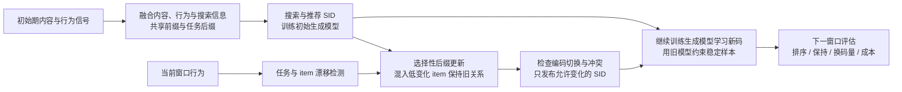

# TemGenSAR

**Temporal Semantic IDs for Generative Search and Recommendation**

TemGenSAR 研究联合生成式搜索与推荐中的 Semantic ID（SID，语义编码）怎样随时间更新。item 是要检索的商品、视频或电影；它的编码分为 **共享前缀 + 任务专属后缀**，前半段由搜索和推荐共用，后半段各自学习。行为关系变化后，选择性修改任务后缀，再让生成模型学会新码。研究重点是排序收益、稳定能力保持与更新成本之间的关系。

本仓库提供研究实现、实验汇总与阶段记录。当前实验快照截至 **2026-09-08**；文档更新不代表新增训练结果。

## 文档

| 内容 | 入口 |
| --- | --- |
| Background / related work：背景、已有方法与问题定位 | [背景与相关工作](docs/background.md) |
| Pipeline / architecture：SID 构建、时序更新与下游对齐 | [方法与框架](docs/method.md) |
| Experiments：按研究问题展开核心实验 | [核心实验](docs/experiments.md) |
| Roadmap：方法改进与待补实验 | [后续研究](docs/roadmap.md) |
| Checkpoints：Hugging Face 模型、固定版本与下载 | [模型发布](docs/model-selection.md) |
| Reproduction：环境、数据依赖与代码入口 | [环境](environment/README.md) · [资产访问](docs/storage.md) · [代码导航](docs/research-status.md) |

## 研究问题

生成式推荐根据用户历史直接生成推荐对象的编码或列表。[TIGER](https://arxiv.org/abs/2305.05065)奠定了基于语义编码预测下一 item 的路线，[OneRec](https://arxiv.org/abs/2502.18965)进一步研究统一召回与排序，并用偏好优化改进生成结果。TemGenSAR 在这些基础上研究联合搜推的时序编码更新；当前代码基于 GenSAR，尚未复现 OneRec 的列表生成与偏好训练。

[GenSAR](https://doi.org/10.1145/3705328.3748071) 等方法利用离散 item 编码统一搜索与推荐。协同行为随时间变化后，固定 SID 可能过时；更新 SID 又会改变生成目标和历史输入，带来迁移成本。已有研究分别探索持续更新编码、新旧符号对应，以及让编码直接服务推荐目标，详见[相关工作](docs/background.md)。

TemGenSAR 进一步考察：**在两个任务共享生成模型的条件下，能否只更新需要变化的任务后缀，并使下游排序收益覆盖换码造成的扰动？**

## Pipeline



最新 MovieLens 实验固定共享前缀与搜索编码，仅更新推荐后缀。比较两种力度：只更新推荐表示的小模块、冻结码本（TASR-A），以及允许推荐码本和表示解码器更新、对齐新旧 token 后再发布局部换码（TASR-B）。码本是一组把连续表示映射到离散 token 的向量中心；表示解码器用于从编码还原输入向量，不同于生成目标 SID 的 T5 解码器。两组均继续训练 T5-small。TASR 是历史系列代号，原记录未定义英文全称；A/B 用于对应两种实现。[组件差异与架构图](docs/method.md)

## 核心实验：按问题逐步展开

[实验主文](docs/experiments.md)按“为什么做、怎样比较、结果如何、引出什么问题”组织，而不是按历史版本编号排列：

表中 nDCG@10 衡量正确目标在前十中的排序位置，越高越好；相对增益不是百分点。随机种子用于重复训练、观察波动，当前多种子主要覆盖增量训练阶段。

| 研究问题 | 实验与主要发现 |
| --- | --- |
| 共享前缀与任务后缀是否有效？ | Amazon 静态对照中，相同下游训练下，搜索与推荐四项指标均优于复现的 GenSAR 编码；当前为单 seed 证据 |
| 行为变化后，该更新谁？ | 漂移驱动局部更新相对固定编码，早期公平三 seed 对照的推荐 nDCG@10 约 +7.99% |
| 换码收益体现在哪里？ | 受控搜索漂移中，119 条换码目标样本的 nDCG@10 约 +26.46%；全体搜索约 +0.88% |
| 检测器是否优于简单规则？ | 加入按交互量选 item 的强对照后，复杂选择策略的优势不稳定 |
| 更多对齐训练能解决吗？ | 重复对齐只改善局部，整体推荐与搜索可能退化；推荐专用 LoRA 也未解决任务内部干扰 |
| 自然变化下是否成立？ | MovieLens 最新严格三 seed 对照，全体推荐 nDCG@10 约 +0.12%，搜索基本保持；KuaiSAR 则提示应允许不更新 |

上述是不同实验的结论，不能跨数据集直接比较绝对指标。**26.46% 是受控搜索漂移的换码目标子集收益**，并非整体搜推提升，也不对应已发布的 MovieLens checkpoint。

这些结果将后续研究聚焦到三个问题：更好的新旧 SID 对齐、把排序收益与迁移成本纳入换码决策，以及检验能否将任务后缀缩为一个 token。[方法改进与单后缀实验计划](docs/roadmap.md)

需要核对配置或原始代号时，参阅[实验细节与完整表格](docs/experiment-details.md)和[术语与名称对照](docs/glossary.md)。

## 模型与数据

精选的 **10 个 MovieLens-25M T5-small checkpoint** 与配套 SID 已上传至 [Hugging Face：Ferriswheel1412/TemGenSAR-MovieLens25M](https://huggingface.co/Ferriswheel1412/TemGenSAR-MovieLens25M)。模型仓库现已**公开**，可无需登录下载模型与配套 SID。

- 模型：共同初始模型（t0），以及固定编码、冻结码本更新、刷新码本更新各三个随机种子；目录分别为 Frozen / TASR-A / TASR-B。
- 固定 revision：`803fbdc690e8d80f5f2b4450bb2838c96c26530a`。
- 配套资产：SID checkpoint、部署映射、item catalog、汇总指标与校验清单。
- [模型目录与下载示例](docs/model-selection.md)；[数据依赖与可复现范围](docs/storage.md)。

## 代码与运行

```text
Search_Reconmendation/stage3/scripts/   数据、表示、SID、时序更新与评估
Search_Reconmendation/stage3/results/   机器可读汇总结果
Search_Reconmendation/stage3/tests/     研究测试
Search_Reconmendation/files/PhaseSummary/  历史实验记录
external/GenSAR/                       后期下游实现，含蒸馏与 LoRA
Search_Reconmendation/external/         早期基线与第三方源码
docs/                                 研究文档
assets/                               模型注册表与来源清单
```

运行环境为 Linux、Bash、Python 3.12 与 PyTorch。安装与路径适配见[环境说明](environment/README.md)，实验脚本入口见[代码导航](docs/research-status.md)。训练和评估还需要对应数据及 SID 资产；目前尚未完成干净环境下的端到端复现验证。

研究代码基于 [GenSAR](https://github.com/TengShi-RUC/GenSAR) 等项目，保留历史目录拼写与两份不同修改的 GenSAR 副本。上游版本和使用范围见[第三方来源](docs/third-party.md)。
