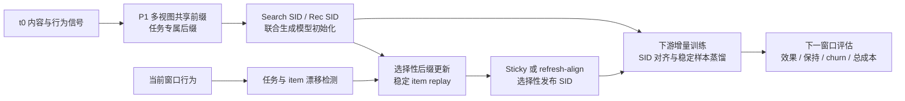

# TemGenSAR

**Temporal Semantic IDs for Generative Search and Recommendation**

TemGenSAR 研究联合生成式搜索与推荐中的 Semantic ID（SID）演化：将 item 表示为 **共享前缀 + 任务专属后缀**，在行为分布变化时选择性更新任务后缀，并使下游生成模型适应新的 SID。研究重点是更新收益、编码稳定性、跨任务保持与更新成本之间的关系。

本仓库提供研究实现、实验汇总与阶段记录。当前实验快照截至 **2026-09-08**；文档更新不代表新增训练结果。

## 文档

| 内容 | 入口 |
| --- | --- |
| Background / related work：背景、已有方法与问题定位 | [背景与相关工作](docs/background.md) |
| Pipeline / architecture：SID 构建、时序更新与下游对齐 | [方法与框架](docs/method.md) |
| Experiments：协议、总体指标、换码子集与失败案例 | [实验结果](docs/experiments.md) |
| Roadmap：方法改进与待补实验 | [后续研究](docs/roadmap.md) |
| Checkpoints：Hugging Face 模型、固定版本与下载 | [模型发布](docs/model-selection.md) |
| Reproduction：环境、数据依赖与代码入口 | [环境](environment/README.md) · [资产访问](docs/storage.md) · [代码导航](docs/research-status.md) |

## 研究问题

[GenSAR](https://doi.org/10.1145/3705328.3748071) 等方法利用离散 item 编码统一搜索与推荐。协同行为随时间变化后，固定 SID 可能过时；更新 SID 又会改变生成目标和历史输入，带来迁移成本。已有持续 tokenization、SID refresh/alignment 与可微 SID 工作为这一问题提供了基础，详见[相关工作](docs/background.md)。

TemGenSAR 进一步考察：**在两个任务共享生成模型的条件下，能否只更新需要变化的任务后缀，并使下游排序收益覆盖换码造成的扰动？**

## Pipeline



最新 MovieLens 实验固定共享前缀与 Search SID，仅更新 Rec 后缀。TASR-A 冻结 codebook；TASR-B 刷新 Rec codebook 后执行 token 对齐与选择性发布。下游采用 T5-small 全参数增量训练；历史 task-local LoRA 是独立实验分支。[实现细节与架构图](docs/method.md)

## 实验概览

相对提升均按 `(method − baseline) / baseline` 计算。不同数据集、候选规模和评估子集之间不直接比较绝对指标。

| 实验 | 对比与范围 | nDCG@10 | 证据范围 |
| --- | --- | --- | --- |
| Amazon / GenSAR，受控 Search 漂移 | Selective vs Fixed，实际换码目标子集 | **0.12625 → 0.15965，约 +26.46%** | 119 条样本，3 个增量训练 seed；全体 Search 为 0.04112 → 0.04148 |
| Amazon，受控 Rec 漂移 W6→W7 | V3 vs Fixed，全体 Rec | 0.019476 → 0.020050，约 +2.95% | 3 seed；对 SupportTopK 的优势较弱 |
| MovieLens-25M，自然 Rec 漂移 W1→W2 | TASR-B vs Frozen，全体 Rec | 0.286285 → 0.286628，约 +0.12% | 3 seed；H@10 不变，Search 基本保持 |
| MovieLens-25M，同一实验 | TASR-B vs Frozen，A/B 换码目标并集 | 0.029864 → 0.031397，约 +5.13% | 326 条样本；子集 bootstrap 区间仍跨 0 |

**26.46% 对应受控 Search 漂移下的换码目标子集**，不能外推为整体搜推效果或自然漂移收益。完整表格、协议、统计范围及失败案例见[实验结果](docs/experiments.md)。

## 模型与数据

精选的 **10 个 MovieLens-25M T5-small checkpoint** 与配套 SID 已上传至 [Hugging Face：Ferriswheel1412/TemGenSAR-MovieLens25M](https://huggingface.co/Ferriswheel1412/TemGenSAR-MovieLens25M)。模型仓库现已**公开**，可无需登录下载模型与配套 SID。

- 模型：共同 t0、Frozen / TASR-A / TASR-B 各 3 seed。
- 固定 revision：`803fbdc690e8d80f5f2b4450bb2838c96c26530a`。
- 配套资产：SID checkpoint、部署映射、item catalog、汇总指标与校验清单。
- [模型目录与下载示例](docs/model-selection.md)；[数据依赖与可复现范围](docs/storage.md)。

## 代码与运行

```text
Search_Reconmendation/stage3/scripts/   数据、表示、SID、时序更新与评估
Search_Reconmendation/stage3/results/   机器可读汇总结果
Search_Reconmendation/stage3/tests/     研究测试
Search_Reconmendation/files/PhaseSummary/  历史实验记录
external/GenSAR/                       后期下游实现，含蒸馏与 LoRA
Search_Reconmendation/external/         早期基线与第三方源码
docs/                                 研究文档
assets/                               模型注册表与来源清单
```

运行环境为 Linux、Bash、Python 3.12 与 PyTorch。安装与路径适配见[环境说明](environment/README.md)，实验脚本入口见[代码导航](docs/research-status.md)。训练和评估还需要对应数据及 SID 资产；目前尚未完成干净环境下的端到端复现验证。

研究代码基于 [GenSAR](https://github.com/TengShi-RUC/GenSAR) 等项目，保留历史目录拼写与两份不同修改的 GenSAR 副本。上游版本和使用范围见[第三方来源](docs/third-party.md)。
