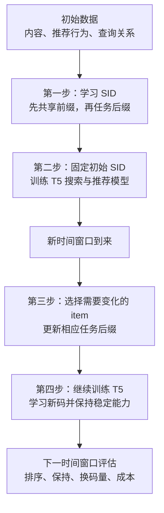

# TemGenSAR

**Temporal Semantic IDs for Generative Search and Recommendation**

TemGenSAR 研究：**搜索和推荐共用一个生成模型时，怎样更新已经过时的 item 编码，让模型学会新码，同时保留稳定 item 和另一任务的效果？**

item 是要检索的商品、视频或电影，SID（Semantic ID，语义编码）是模型逐个生成的离散符号序列。本页从方法和实验两条线介绍项目，不要求读者预先熟悉内部代号。实验记录截至 **2026-09-08**；改进方向属于待验证方案。

## 1. 方法：初始训练两步，再进行时序更新

主体可以理解为“先学 SID，再用 SID 训练生成模型”。但 **SID 不只来自文本语义，还使用行为和查询关系**；两步完成后，系统还需要适应后续时间窗口。

例如，同一部电影可以有两套编码，数字仅作示意：

```text
搜索 SID：[12,83 | 4,91]
推荐 SID：[12,83 | 7,35]

推荐关系变化后：
旧推荐 SID：[12,83 | 7,35]
新推荐 SID：[12,83 | 8,35]
```

前两个位置是搜索与推荐共用的“共享前缀”，后两个是各自的“任务后缀”。只修改推荐后缀时，搜索编码可以保持不变。但旧生成模型熟悉旧码，所以还要训练它接受新码。



### 第一步：学习 SID

先为每个 item 准备三种连续向量：

| 信息 | 使用的模型或方法 | 它描述什么 |
| --- | --- | --- |
| 内容 | BGE 文本编码器处理标题、描述等 | item 本身是什么 |
| 行为 | UniSAR 行为表征模型，从交互历史学习 item 向量 | 哪些 item 在用户行为中有联系 |
| 搜索 | 编码与 item 相关的查询，再按频次等聚合；也支持预计算向量 | 用户通过什么查询找到它 |

UniSAR 是行为信息准备环节的模型，主要训练区分真实交互和负样本、匹配查询与 item，并协调单任务和混合历史表示。向量准备好后，SID 模型再学习离散编码，当前并未将所有模块与最终 T5 一起端到端训练。

**先学共享前缀。** 小型神经网络分别处理三种向量，学习融合权重，再做两层残差量化：第一套码本选一个中心解释向量，第二套码本解释剩余部分，得到两个编号。码本是一组向量中心，每层通常有 256 个。

**再固定前缀，学习任务后缀。** 搜索、推荐分别使用一个 adapter，即学习任务专属表示的小型网络。推荐后缀采用两层残差量化；搜索后缀分别侧重查询相关性与 item 身份区分，并非所有后缀都是相同的“两次残差量化”。

SID 阶段的主要训练目标如下。具体权重和组合随实验版本不同。

| 训练部分 | 主要 loss | 通俗含义 |
| --- | --- | --- |
| 共享前缀 | 三路信息的重构误差、量化约束、码本使用约束、融合权重约束 | 压缩后保留有用信息，连续向量与中心相容，减少只用少数编号或单路输入的倾向 |
| 任务后缀 | 完整表示与搜索身份信息重构、查询匹配对比损失、item 关系保持、量化约束 | 补充任务信息，保留相关 item 之间的关系，并区分不同目标 |

训练使用 AdamW；离散选码通过直通估计近似传递梯度，即前向实际选中心、反向用近似梯度更新网络。还需要处理不同 item 获得相同完整 SID 的碰撞问题，部分实验使用 Sinkhorn 分配调整。

**这些目标主要优化表示与编码，尚未直接优化最终推荐 nDCG。** 后缀训练中的表示解码器负责还原向量，也不同于下一步生成 SID 的 T5 解码器。[模型框架、损失解释与结构变体](docs/method.md)

### 第二步：固定 SID，训练下游生成模型

下游使用 **T5-small**，沿用 GenSAR 的联合搜推任务组织：

```text
推荐：用户行为历史 → 目标 item 的推荐 SID
搜索：查询 + 用户历史 → 目标 item 的搜索 SID
```

推荐可以参考搜索历史，搜索也可以参考推荐历史。初始训练还包括 item 文本与 SID 的双向辅助任务、从历史预测查询，以及使用构造查询训练搜索，帮助文本、行为和编码建立联系。

使用自回归监督训练：给出正确的前面 token，预测下一个 token。主要 loss 是序列交叉熵：

$$
L_{\mathrm{CE}}=-\operatorname{mean}_{t\in\mathrm{valid}}\log p(y_t\mid x,y_{<t})
$$

这里 x 是查询、历史和任务提示，y 是正确输出。**nDCG 用于验证和评估，不是当前 T5 的直接训练 loss。**

推理时，模型在有效 SID 路径中逐步生成，再查映射表得到 item。到此完成初始模型训练。

### 第三步：新数据到来后，选择性更新 SID

根据当前及历史窗口的行为变化选择候选：推荐侧检查交互关系，搜索侧检查查询关系，后续策略还考虑当前交互量。候选不一定最终换码，收益不足或发生冲突时可以保留旧码。

编码模块训练还混入少量低变化 item，以旧表示约束它们，帮助保留稳定关系；这称为样本回放（replay）。

最新 MovieLens 推荐更新比较两条路线：

| 组件 | A：冻结码本的局部更新 | B：刷新码本后对齐 |
| --- | --- | --- |
| 共享前缀、搜索编码 | 固定 | 固定 |
| 推荐 adapter | 更新 | 更新 |
| 推荐后缀码本、表示解码器 | 固定 | 更新 |
| 编码处理 | 在旧码本中选码，加入保留旧码的偏好 | 先对应新旧 token，再发布局部换码 |
| SID 阶段可训练参数 | 14,528 | 114,176 |
| MovieLens 实际换码 | 25 个 item | 67 个 item |

历史文件称它们为 TASR-A/B；TASR 是原记录未定义英文全称的系列代号。两者核心区别是推荐码本与表示解码器能否更新。

更新损失包括当前关系重构、item 关系保持、量化，以及稳定 item 接近旧表示的约束。最终还单独构造部署映射，显式保留未选 item 的原码，避免共享参数更新连带改变全目录。

### 第四步：让生成模型学会新码，并保持稳定能力

固定编码、A、B 三组都从同一个初始 T5 出发，用相同当前数据与预算继续训练。**固定编码基线也训练下游模型**，这样才能检验改 SID 是否提供额外价值。最新严格对照中，三组下游都是 T5 全参数训练一轮。

训练包含主任务交叉熵、item 与新推荐 SID 的双向辅助任务，以及旧模型对稳定样本的蒸馏：

$$
L=L_{\mathrm{CE}}+
0.1T^2\operatorname{mean}_{\text{稳定样本有效位置}}
D_{\mathrm{KL}}(q_T\|p_T),\qquad T=2
$$

q 是旧教师，p 是更新中的学生。KL 方向为 **teacher‖student（forward KL）**。交叉熵学习数据中的正确答案，蒸馏用教师的概率分布保留旧判断。

当前教师和学生读取相同编码输入，并沿正确标签序列训练；目标或推荐历史涉及换码时，关闭整条样本的蒸馏。它尚未让教师读旧历史、学生读新历史，也未使用学生自己生成的轨迹，因此 **当前不是 on-policy distillation（OPD）**。相关改进见下文与[研究计划](docs/roadmap.md)。

## 2. 实验：在哪些数据上，研究了哪种变化？

自然漂移指真实时间序列中的关系变化；人工漂移指主动改变部分查询或交互，制造可控变化。数据包含搜索和推荐，不等于两个任务都验证了自然漂移。

| 数据集 | 推荐侧 | 搜索侧 |
| --- | --- | --- |
| Amazon Electronics，约 2 万 item | 自然时间变化，也做了人工推荐关系变化 | 静态实验与人工查询关系变化；还与自然推荐变化组合做联合更新 |
| KuaiSAR | 真实日志中的自然推荐变化 | 用真实搜索日志测保持性，未形成自然搜索漂移更新的可靠正向结论 |
| MovieLens-25M，18,191 个固定 item | 自然推荐行为变化 | 固定查询/标签库构造的搜索任务，是稳定性参照，不是自然搜索漂移 |

指标 nDCG@10 同时考虑命中与前十中的位置，越大越好；H@10 只看是否进入前十。相对百分比按“新值 / 基线值 − 1”计算。

### 静态实验：这套 SID 本身是否有效？

Amazon 严格划分中，两种编码使用相同下游训练协议：

| 编码 | 推荐 nDCG@10 | 搜索 nDCG@10 |
| --- | ---: | ---: |
| 复现的 GenSAR 编码 | 0.01946 | 0.02980 |
| 本项目共享前缀与任务后缀 | **0.05034** | **0.07740** |
| 相对变化 | +158.7% | +159.7% |

这是一次训练复现中对整套编码方案的比较，不能把差异全归因于某一个结构改动，也不构成对所有最新方法的全面优势。[划分与结果来源](Search_Reconmendation/files/PhaseSummary/实验结果对齐_2026-08-12.md)

### 时序实验：局部更新是否比固定编码更好？

下表的主要基线是“SID 固定，但生成模型同样用新数据继续训练”。单窗口与连续窗口是不同实验，不能把它们串成同一条性能曲线。

| 实验 | 主要结果 | 结论范围 |
| --- | --- | --- |
| Amazon，自然推荐变化，单次更新 | 推荐 nDCG 0.028642 → 0.030931，约 **+7.99%**，三个增量训练种子 | 搜索基本保持；仅是单窗口收益 |
| Amazon，人工搜索变化 | 全体搜索 0.04112 → 0.04148，约 **+0.88%**；119 条换码目标请求约 **+26.46%** | 三种子均值，推荐基本保持；强收益来自局部子集 |
| Amazon，九个未来窗口连续联合更新 | 推荐 0.024352 → 0.024321，约 **−0.13%**；搜索 0.031124 → 0.031977，约 **+2.74%** | 搜索为人工变化、推荐为自然变化；一条训练轨迹，长期推荐收益未保持 |
| Amazon，人工推荐变化 | 中期窗口全体推荐约 **+2.95%**；更晚留出窗口约 **+5.02%** | 相对固定编码有效，但未稳定超过“按当前交互量选择”的简单规则 |
| KuaiSAR，自然推荐变化 | 后续三种子强制更新：推荐约 0.11103 → 0.11059；保守过滤避免退化，但最佳总体增益仅 +0.000049 | 观察期短、目标跨窗复现少，未得到可靠推荐正收益 |
| MovieLens，自然推荐变化 | 刷新码本后对齐：推荐 0.286285 → 0.286628，约 **+0.12%**；搜索基本保持 | 三种子均值，推荐 H@10 不变；已发布模型来自这里 |

**26.46% 的准确含义：** 人工搜索漂移实验中，15 个 item 实际换码，下一窗口 5,000 条搜索请求中有 119 条以它们为正确目标。这个相同子集的 nDCG 从 0.12625 提高到 0.15965。它不是整体搜推提升，也不对应目前发布的 MovieLens 模型。

MovieLens 在 A/B 换码目标的并集（326 条测试请求）上约 +5.13%，但样本层面的置信区间包含零；A/B 之间差异也不显著。连续更新实验及其后续多种子检查，则提示推荐退化不能简单归为某次训练随机波动。

已有诊断还发现：增加换码 item 的对齐次数，只使局部目标小幅改善，却可能损害整体搜索和推荐；只训练推荐专用低秩附加参数（LoRA），可以保持搜索，却没有解决未换码推荐目标退化。新旧编码兼容是当前的重要瓶颈。

[核心实验故事线](docs/experiments.md) · [协议、完整指标与统计](docs/experiment-details.md) · [九窗口滚动结果](Search_Reconmendation/files/PhaseSummary/阶段7_R3_MultiWindowRolling_2026-09-03.md)

### 评估口径

Amazon 主要在“1 个正例 + 999 个负候选”中排序，MovieLens 主要为“1 + 99”；这些结果不能当作全目录检索成绩，也不能跨候选规模比较绝对值。多个增量训练种子共用初始模型，尚未覆盖完整独立训练的随机性。

当前证据支持局部更新的可行性与受控搜索子集收益；自然推荐收益较小，长期稳定性仍需改进。

## 3. 改进方向：怎样让教师真正帮助学生学习新 SID？

以下均为待验证方案：

1. **教师读旧历史，学生读新历史。** 对同一段行为分别按旧、新 SID 编码，让教师在熟悉的输入上提供指导。
2. **比较同一 item，而非强行比较旧、新 token。** 教师用 item 的旧 SID 打分，学生用新 SID 打分，在相同候选集合上蒸馏其相对判断。
3. **区分编码迁移与偏好变化。** 编码换了但关系稳定时，可以保留较强教师约束；真实偏好变化时，应更多学习当前行为，降低旧教师权重。
4. **再检验学生生成候选。** 由学生提出 item 候选、教师用旧编码评分，研究能否覆盖学生实际容易走到的路径。它借鉴 OPD 思路，但不能直接等同于严格的逐 token OPD。
5. **独立验证单 token 后缀。** 保留两个任务各自的后缀，先将推荐后缀从两个 token 缩为一个；与蒸馏修改分开做，避免同时改变多个因素。

[改进设计、教师可靠性、对照实验与成本要求](docs/roadmap.md)

## 4. 模型、运行与进一步阅读

精选 **10 个 MovieLens-25M T5-small checkpoint** 与配套 SID 已在 [Hugging Face](https://huggingface.co/Ferriswheel1412/TemGenSAR-MovieLens25M) **公开**，可无需登录下载：共同初始模型，以及固定编码、冻结码本更新、刷新码本更新各三个随机种子。

固定版本为 `803fbdc690e8d80f5f2b4450bb2838c96c26530a`。[模型目录、SID 配套关系与加载示例](docs/model-selection.md) · [数据依赖与资产访问](docs/storage.md)

| 阅读目的 | 入口 |
| --- | --- |
| 生成式推荐、OneRec、联合搜推与本项目的研究联系 | [背景与相关工作](docs/background.md) |
| 模型结构、loss、A/B 与历史变体解释 | [方法与框架](docs/method.md) |
| 完整实验故事与数值核对 | [核心实验](docs/experiments.md) · [实验细节](docs/experiment-details.md) |
| 缩写与术语回查 | [名称对照](docs/glossary.md) |
| 安装与具体代码入口 | [环境](environment/README.md) · [代码导航](docs/research-status.md) |

```text
Search_Reconmendation/stage3/scripts/   数据、表示、SID、时序更新与评估
Search_Reconmendation/stage3/results/   机器可读汇总结果
Search_Reconmendation/stage3/tests/     研究测试
Search_Reconmendation/files/PhaseSummary/  历史实验记录
external/GenSAR/                       后期生成模型实现，含蒸馏与 LoRA
docs/                                 研究说明与计划
assets/                               模型注册表与来源清单
```

运行环境为 Linux、Bash、Python 3.12 与 PyTorch。脚本保留部分历史绝对路径，训练/评估还需要对应数据和 SID，尚未完成干净环境的端到端复现验证。

本项目使用 [GenSAR 官方实现](https://github.com/TengShi-RUC/GenSAR)作为下游基础；[TIGER](https://arxiv.org/abs/2305.05065)与[OneRec](https://arxiv.org/abs/2502.18965)分别提供语义编码推荐与召回排序统一、偏好对齐方面的研究基础。目前尚未复现 OneRec 的列表生成与偏好训练。第三方版本、两份 GenSAR 修改副本与使用范围见[源码来源](docs/third-party.md)。
