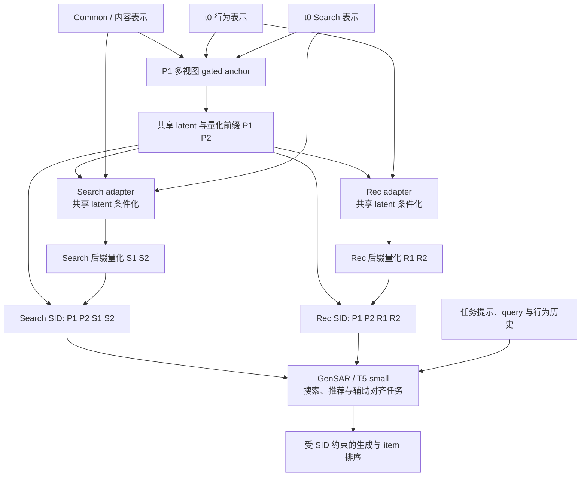

# 方法与框架

本页描述截至 2026-09-08 的已实现系统。阅读顺序是：先给 item 建立编码，再检测行为变化，只更新需要变化的后缀，最后让生成模型适应新编码。实验动机与结果见[核心实验](experiments.md)，代号和术语见[名称对照](glossary.md)。

最新 MovieLens 对照包括两条路线：**冻结码本的局部更新（TASR-A）**与**刷新码本后对齐（TASR-B）**。码本是将连续表示量化成离散 token 的向量集合；A 只改任务 adapter，B 也允许码本与解码器变化。受控 Search 漂移和推荐专用 LoRA 属于其他实验分支。

## 1. 模块化 SID 与 t0 模型

同一 item 在两个任务中共享前缀，并使用各自后缀：

```text
Search SID(i) = [P1(i), P2(i) | S1(i), S2(i)]
Rec SID(i)    = [P1(i), P2(i) | R1(i), R2(i)]
```

每层 codebook 的典型大小为 256。前缀是量化后的共享表示；后缀保留任务信息。完整 SID、item ID 与下游 token 词表之间必须保持一致，不能仅替换模型权重而沿用不匹配的映射。

主干方案在历史记录中称为 P1/v13b：融合内容（common）、行为与 Search 三种表示，先学习一个共享的连续表示（anchor），再量化为前缀。任务 adapter 是学习搜索或推荐专属表示的小模块，以共享表示为条件，再产生任务后缀。输入表示由对应数据构建器提供；MovieLens 的 Search 使用固定 query/tag bank。



SID 学习包括表示重构、拓扑保持、量化 commitment，以及对应分支的 relevance / identity 等约束；并非所有实验使用相同 loss。当前主干 SID 训练与 T5 排序训练分阶段进行，尚未将序列条件排序目标端到端反传至离散 SID。

代码：[共享前缀训练](../Search_Reconmendation/stage3/scripts/train_multiview_anchor_prefix_v13.py)、[任务后缀 tokenizer](../Search_Reconmendation/stage3/scripts/build_neural_rq_sid_v9_direct_private.py)。共识前缀（P2）、增加残差重构（P1-R）及进一步增加序列邻域信息（P1-RN）是对照变体，未替代当前主干；[结构实验解释](experiment-details.md)。

## 2. 漂移检测与候选选择

检测与选择使用当前及历史窗口信息，下一窗口用于评估。Search 分支检查 query 分布与表示中心的变化；Rec 分支检查行为及相邻交互关系的变化。后续的“漂移 × 支持量”策略（V3）进一步考虑当前交互数，避免只选变化很大但很少出现的 item。最新 MovieLens 实验选出 150 个候选 item，配置中写作 K150。

候选集合与实际换码集合不同：部分候选在更新后仍保留原 SID。低支持量、漂移不确定 item 与低漂移 replay 应分别处理，任务未触发漂移时允许 no-op。

## 3. 选择性更新与部署映射

最新实验固定 shared prefix 与 Search 分支，比较两个 Rec 更新版本：

| 组件 | TASR-A | TASR-B |
| --- | --- | --- |
| Rec adapter | 更新 | 更新 |
| Rec suffix codebook / decoder | 冻结 | 更新 |
| SID 可训练参数量 | 14,528 | 114,176 |
| 新旧编码处理 | Sticky assignment，限制无必要切换 | 逐层 Hungarian token 对齐，再选择性发布 |
| 可改动范围 | Detector 候选的 Rec suffix | Detector 候选的 Rec suffix |
| MovieLens 实际换码 | 25 / 18,191 items | 67 / 18,191 items |

训练使用 selected item 与低漂移 replay，损失包括重构、拓扑、commitment 和稳定性等项。adapter 是共享函数，即使只在少量 item 上训练，直接重新量化全目录仍会改变其他 item。因此需要单独构建 **operational SID mapping**，显式固定未选 item。

TASR-B 的 Hungarian 对齐降低新旧 codebook 的 token 置换差异；发布阶段还检查候选是否与冻结 catalog 冲突。部署映射与 raw refresh 的 collision 不同：MovieLens A/B 部署映射均有 18,191 个唯一完整 SID。历史 Amazon 实验允许保留已有 collision，不能沿用零碰撞结论。

代码：[Rec 选择性更新](../Search_Reconmendation/stage3/scripts/update_v13b_rec_adapter_selective.py)、[Rec sticky assignment](../Search_Reconmendation/stage3/scripts/materialize_v13b_temporal_rec_sid_sticky.py)、[token 对齐与发布](../Search_Reconmendation/stage3/scripts/align_and_materialize_rec_suffix.py)。

## 4. 下游 SID 对齐与知识保持

Frozen、A、B 从同一 t0 T5-small checkpoint 出发，使用相同当前窗口数据、辅助对齐池与训练预算。Frozen 保持 SID，但同样进行下游增量训练，因而是 downstream-only 对照。

最新严格实验包含两个主任务与 `CollaborativeItem2Index` / `CollaborativeIndex2Item`。目标由生成交叉熵与稳定样本上的 teacher token KL 组成；teacher 为共同 t0 模型，KL 温度 2.0、权重 0.1。实际换码影响 target 或 Rec history 的样本关闭旧 teacher 蒸馏，避免约束模型继续预测旧编码。此 mask 也会关闭部分带已变化 Rec history 的 Search 样本蒸馏。

当前实现对保留样本使用 teacher/student 的同一编码输入，并按样本启停 KL；尚未实现 teacher 使用旧历史、student 使用新历史的双视图对齐，也未实现 item-space 蒸馏。[改进方向](roadmap.md)

下游为 **T5 全参数 1 epoch 增量训练**，SID adapter 参数量不代表下游可训练参数量。严格对照未启用额外 `CollaborativeSIDMigration` 任务。历史 task-local LoRA 可隔离部分跨任务干扰，但未成为最新严格实验的默认方案。

代码：[受影响样本与蒸馏 mask](../Search_Reconmendation/stage3/scripts/build_affected_rec_adapter_dataset.py)、[T5 训练入口](../Search_Reconmendation/stage3/scripts/run_movielens25m_temporal_distill_t5.sh)、[下游 trainer](../external/GenSAR/finetune/modules/trainer.py)。

## 5. 下一窗口评估与成本

报告全体 Rec / Search、detector-selected 与实际换码 target 子集、未换码子集、collision、churn 与成本。换码 target 子集只用于诊断，不能作为推理时依赖真实 target 的路由条件。

表示构建、检测、SID 更新、映射发布、下游训练与评估时间应分别报告。当前记录中的 15.75 / 21.88 秒仅对应 A/B 的 SID 更新训练阶段，不能解释为端到端更新时间。[完整协议与结果](experiments.md)
