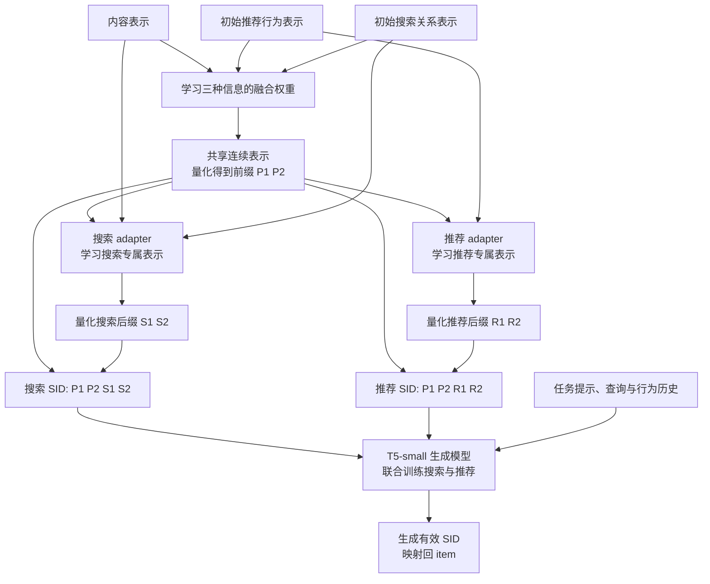

# 方法与框架

系统分两阶段：先学习 item 编码与初始生成模型，再根据新时间窗口的行为选择性更新编码，并继续训练生成模型。这里描述截至 2026-09-08 的已实现方法；[核心实验](experiments.md)解释各项设计的证据。

## 1. 一个 item 怎样变成 SID？

SID（Semantic ID，语义编码）是由多个离散 token 组成的 item 标识。token 可以理解为模型能够逐个输出的符号。当前同一 item 有两套编码：

```text
搜索 SID = [P1, P2 | S1, S2]
推荐 SID = [P1, P2 | R1, R2]
```

P1、P2 表示共享前缀的两个位置；S1、S2 是搜索后缀，R1、R2 是推荐后缀。同一 item 的前缀相同，后缀可以不同。每个位置通常有 256 个可能符号，由对应的**码本**提供：码本是一组向量中心，量化器把连续表示匹配到这些中心，从而选出离散 token。

“共享”表示两个任务使用同一段编码，不代表前缀只包含内容信息；当前前缀融合了内容、推荐行为和搜索关系。

## 2. 怎样学习初始编码和生成模型？

### 从三种信号形成共享前缀

先提取 item 的内容表示、推荐行为表示和搜索关系表示。表示是用于描述这些信息的连续向量。融合模块根据输入决定三种表示的权重，再将融合结果量化为共享前缀。这种学习加权的机制在实现中称为门控融合（gated fusion）。

初始训练完成的时点记为 t0。之后的时序更新默认固定这套前缀，避免一个任务的变化直接改动两任务共用的编码。

### 为两个任务学习各自的后缀

搜索和推荐分别使用一个 adapter，即学习任务专属表示的小型神经网络。adapter 读取任务信息，并以共享表示为条件产生后缀表示，再经量化得到搜索或推荐 token。

后缀的**解码器**是从量化表示还原原始向量的网络，用于 SID 训练；它不同于后面生成目标 SID 的 T5 解码器。



SID 训练主要检验：量化后的表示能否还原输入信息，item 之间的邻近关系是否保留，以及连续表示与所选码本中心是否接近。代码分别称为重构、拓扑保持与 commitment 约束；搜索分支还包含查询相关性与 item 身份区分等损失，具体组合随实验不同。

然后使用初始 SID 训练 T5-small。该模型采用 GenSAR 的联合搜推任务框架，根据查询、行为历史与任务提示逐步生成目标编码。当前 SID 与 T5 分阶段训练，排序目标尚未端到端反传至离散编码。

[共享前缀代码](../Search_Reconmendation/stage3/scripts/train_multiview_anchor_prefix_v13.py) · [任务后缀代码](../Search_Reconmendation/stage3/scripts/build_neural_rq_sid_v9_direct_private.py)

### 历史结构变体具体改了什么？

主干在历史记录中名为 **P1/v13b**。这里的“P1 方案”是版本名，与上面的“第一个前缀位置 P1”含义不同。为避免混淆，下文优先使用描述性名称。

| 原记录代号 | 改动 | 为什么比较它 |
| --- | --- | --- |
| P1/v13b：多视图融合主干 | 内容、搜索、推荐三种表示通过门控融合形成前缀 | 作为当前默认结构 |
| P2：共识前缀 | 以内容表示为中心，只有限地加入搜索与推荐共同支持的信息，减小任务信号对前缀的影响 | 检查更强调共性、把任务差异留给后缀是否更好 |
| P1-R：显式残差重构 | 保持主干前缀，在后缀训练中补入此前只计算但未纳入最终损失的残差与完整表示重构误差 | 检查后缀是否更准确地编码了前缀未解释的信息 |
| P1-RN：残差重构 + 序列邻域增强 | 在 P1-R 上混合某 item 与推荐序列中相邻 item 的表示；仅使用初始训练期行为 | 检查加入局部共现关系能否增强推荐信息 |

“残差”指完整目标表示减去前缀已解释的基准表示，类似让后缀补上剩余部分。“序列邻域”指用户行为序列中相邻出现的 item，而不是未来测试数据。三种变体的结果未支持替代当前主干，详见[结构消融](experiment-details.md)。

## 3. 行为变化后，怎样选择需要更新的 item？

数据按时间分成窗口：W1 表示第一个更新窗口，W2 是其后的测试窗口，以此类推。检测与候选选择只读取当前及历史信息。

搜索分支检查查询分布和查询表示中心是否变化；推荐分支检查行为关系和相邻交互关系是否变化。后续选择策略还加入当前交互量，避免只选变化大、但几乎没有训练信号的 item。这一“漂移分数 × 交互量平方根”的策略在历史记录中称为 V3。

最新 MovieLens 实验选出 150 个候选，配置写作 K150。**候选不是实际换码集合**：有些 item 在后续训练与约束分配后仍使用原码。

训练时还混入少量低漂移 item，使用其旧表示约束更新不要破坏稳定关系；这称为稳定样本回放（replay）。没有足够变化证据时，允许整个窗口保持原码。

## 4. 两种推荐后缀更新路线：A 和 B 差在哪里？

**TASR 是原实验记录中的系列代号，记录未定义英文全称。** 本文保留它以对应模型目录和结果文件，并使用描述性名称解释方法；A/B 只是两个变体的区分标记。

- **冻结码本的局部更新（TASR-A）**：保留连续表示到 token 的码本，只调整推荐 adapter，让需要变化的 item 在旧码本中重新选择编码。它的更新空间较小。
- **刷新码本后对齐（TASR-B）**：同时调整推荐 adapter、后缀码本与表示解码器，给编码更大调整空间；之后先处理新旧 token 对应，再发布选定 item 的新编码。

两者均固定共享前缀和搜索编码，最新严格实验的下游生成模型都继续进行全参数训练。A 的低秩 SID adapter 与另一个实验中的“推荐专用 T5 LoRA”不是同一模块。

| 组件或操作 | 冻结码本的局部更新（A） | 刷新码本后对齐（B） |
| --- | --- | --- |
| 推荐 adapter | 更新 | 更新 |
| 推荐后缀码本与表示解码器 | 冻结 | 更新 |
| 新旧 token 处理 | 在旧码本中分配，并加入保留旧码的偏好 | 先建立新旧 token 对应，再选择性发布 |
| SID 阶段可训练参数 | 14,528 | 114,176 |
| MovieLens 最终换码 | 25 个 item | 67 个 item |
| 共享前缀、搜索编码和未选 item 的部署 SID | 保持 | 保持 |

A 中保留旧码的分配偏好称为 sticky assignment：只有新码相对旧码足够有利时才切换。B 的 token 对齐用 Hungarian（匈牙利）线性分配算法，让新 token 尽量对应旧 token，减少纯编号置换的影响。

adapter 和码本对多个 item 共用，即使仅用少量 item 训练，直接重算全目录仍可能改变未选 item。因此还要单独生成**部署映射**：哪些 item 最终使用哪些 SID。未选 item 显式保持原码；候选新码还需避免与冻结 item 的完整 SID 冲突。MovieLens 的两套最终映射均有 18,191 个唯一完整 SID，历史 Amazon 实验则可能保留原有碰撞。

[选择性更新](../Search_Reconmendation/stage3/scripts/update_v13b_rec_adapter_selective.py) · [保留旧码的分配](../Search_Reconmendation/stage3/scripts/materialize_v13b_temporal_rec_sid_sticky.py) · [token 对齐与部署映射](../Search_Reconmendation/stage3/scripts/align_and_materialize_rec_suffix.py)

## 5. 生成模型怎样学会新 SID，又尽量不遗忘？

固定编码、A、B 三组从同一初始 T5-small 出发，使用相同当前窗口数据、辅助对齐池和训练预算。固定编码组也继续训练 T5，因此可以作为“只更新生成模型”的对照。

最新严格实验包含：

1. **推荐与搜索主任务**：从历史或查询生成正确目标 SID。
2. **item 与推荐 SID 的双向辅助任务**：从 item 信息预测编码，再从编码预测 item 信息；代码名为 CollaborativeItem2Index / CollaborativeIndex2Item。
3. **稳定样本蒸馏**：初始模型作为教师，约束新模型在未受换码影响的样本上保留旧预测分布。实现用 token 级 KL 散度衡量差别，温度 2.0、损失权重 0.1。

目标或推荐历史涉及换码 item 时，当前实现关闭整条样本的旧模型约束，以免强迫新模型继续使用旧编码。这也会关闭部分目标搜索编码未变、但推荐历史变化的搜索样本约束，是待改进处。

当前教师和新模型读取同一个编码输入，尚未实现“教师看旧 SID 历史、新模型看新 SID 历史”的双视图训练，也未在相同 item 候选上对齐新旧预测。[改进计划](roadmap.md)

下游 T5 全参数训练 1 epoch（一轮数据），与表中的 SID 参数量分开计数。严格对照未启用额外的 CollaborativeSIDMigration 任务，即“从旧推荐 SID 预测新 SID”的辅助迁移训练。推荐专用 LoRA 只在另一个实验中验证过：它冻结基础 T5，只训练推荐请求启用的低秩附加参数，未成为最新默认方案。

[受影响样本与蒸馏开关](../Search_Reconmendation/stage3/scripts/build_affected_rec_adapter_dataset.py) · [下游训练入口](../Search_Reconmendation/stage3/scripts/run_movielens25m_temporal_distill_t5.sh) · [训练器实现](../external/GenSAR/finetune/modules/trainer.py)

## 6. 怎样评估更新是否值得？

下一窗口分别检查全体搜索/推荐、实际换码目标和未换码目标，报告排序指标、编码碰撞、换码量与成本。换码目标子集依据真实目标做分析，不能作为线上推理时已知正确答案的路由条件。

成本需要分开列出表示构建、检测、SID 更新、映射发布和下游训练。A/B 的 15.75 / 21.88 秒仅是 SID 更新训练时间，不是全部流程耗时。[结果与解释](experiments.md) · [完整数值与计时口径](experiment-details.md)
